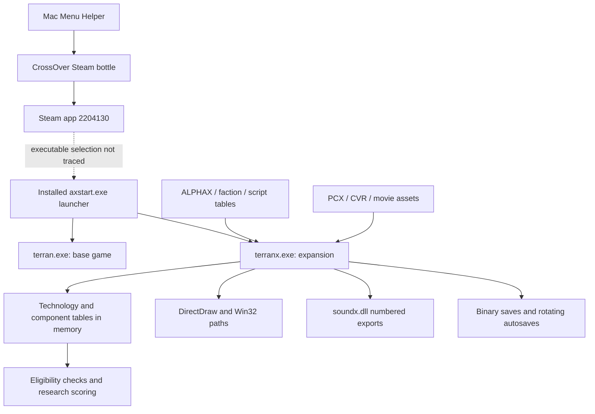

# Alpha Centauri: an evidence-backed internal analysis

This is the initial static-analysis pass. The subsequent [full-game browser work](FULL_GAME_PORT.md) adds turn/state recovery, a map reader, asset import, and browser runtime experiments.

The application in the screenshots is a CrossOver launcher for the Windows **Sid Meier’s Alpha Centauri: Planetary Pack** installation. Its architecture is a native 32-bit engine with substantial gameplay and presentation data in editable files. I used REA with Hopper and Ghidra to inspect the installed executables, then followed selected code paths through rules, technology selection, audio initialization, graphics configuration, and saving.

This is **static analysis of the installed artifacts**, performed on 2026-10-14. During this initial pass the game was not launched or modified; subsequent browser execution is documented in the linked full-game report. Decompiled names such as `FUN_005bdc10` are generated identifiers; descriptive names below are analyst interpretations. A recovered branch establishes what the binary can do, not what a particular play session did.

**Target and reproducibility.** The installation is inside the CrossOver `Steam` bottle at `drive_c/Program Files (x86)/Steam/steamapps/common/Sid Meier's Alpha Centauri`. The Steam manifest identifies app **2204130**, build **12965079**. Most function addresses below refer to **terranx.exe**, the expansion executable, with SHA-256:

```text
573fd44cf18392da7cd048e2d8c24a8e130034364f374647e34e79a6c621d6f4
```

REA/Ghidra identifies an x86 PE application, image base `0x400000`, without managed code. Its overview reports 10,135 procedures and 4,335 defined strings. Hopper reports 13,849 procedures and 4,199 strings; these are provider-dependent analysis inventories, not original-source function counts. [Ghidra overview](analysis/native/overview-terranx.json), [Hopper overview](analysis/setup/hopper-probe.json), [supplemental PE inventory](analysis/native/terranx.exe.inventory.json).



**1. How launching works.** The Mac bundle’s `Info.plist` names `Menu Helper` and a generated CrossOver wrapper. The wrapper invokes `wine --bottle Steam --start` on a Windows `.url` file containing `steam://rungameid/2204130`. Separately, REA decompiled the installed `axstart.exe` launcher: function **0x407620** reads a selection, indexes a filename table, calls `CreateProcessA`, waits for the child, and closes its handles. Pointer-table inspection establishes selection 1 → `terran.exe`, selection 2 → `terranx.exe`.

The precise Steam configuration selecting `axstart.exe` was not recovered, so that connection remains explicitly unverified. The Mac wrapper and the native launcher's behavior are independently established. [Launcher evidence and hashes](analysis/launcher/launch-chain-files.json), [launcher pseudocode](analysis/launcher/launch-process.c), [launcher REA Evidence](analysis/launcher/launch-process-decompile.json).

**2. Rules become fixed tables in memory.** Function **0x5873c0** calls the technology loader and core rules loader, then repeatedly asks the same parser for sections including `TERRAIN`, `CHASSIS`, `REACTORS`, `WEAPONS`, `DEFENSES`, `ABILITIES`, and `FACILITIES`. It stores fields in arrays at fixed addresses and strides. The parser at **0x5fda00** constructs a `#`-prefixed section marker and scans file lines; its integer-token helper at **0x5fd740** consumes comma-delimited text. Core rules at **0x585170** also clamp selected numeric values.

This explains why balance changes can live in text files while the algorithms remain compiled into the executable. The shipped `alpha.txt` documents scenario-local rule overrides. A concrete example: the normal Network Node row declares cost 8 and the tutorial’s `2Build/alpha.txt` declares 2; both use a minerals multiplier of 10, giving declared base costs of **80 versus 20 minerals**, before other modifiers. The path resolver at **0x6005d0** tries several configured directory prefixes, but this pass did not prove which prefix global corresponds to the current scenario.

[Component loader](analysis/native/code-component-loader.c), [section parser](analysis/native/code-section-parser.c), [core rules](analysis/native/code-core-rules.c), [path resolver](analysis/native/code-asset-path-resolver.c), [exact data excerpts, ASSET-01/02/22/25/26](analysis/assets/asset_evidence.json).

**3. Technologies are a dependency graph, with a traced selection algorithm.** Function **0x585e30** reads the `TECHNOLOGY` section twice. First it registers short technology keys and checks for duplicates. Then it loads the display-name reference, four weights, two prerequisites, and flags. Function **0x584d60** translates prerequisite keys into numeric indices; it returns `-1` for `None` and `-2` for `Disable` or an unresolved key after reporting an error.

The loader establishes **89 table slots of 44 bytes each**. Slots include disabled/special entries; this is not a count of selectable research topics. The following layout is inferred from the loader’s stores and corroborating consumers, rather than recovered original type information:

| Record offset | Observed/inferred field |
|---|---|
| `+0x00` | Effect flags |
| `+0x04` | Display-name/string reference |
| `+0x08` | Eight-byte key storage, explicitly terminated at character 7 |
| `+0x10` | Not established in this pass |
| `+0x14 / +0x18 / +0x1c / +0x20` | Growth / technology / wealth / power weights |
| `+0x24 / +0x28` | Two prerequisite indices |

The first record begins at **0x94f358**. A separate byte array at **0x9a6670** is tested with `1 << faction` to determine technology ownership. Eligibility function **0x5bac20** rejects known, disabled, or mode-excluded candidates and checks both prerequisite ownership bits, allowing the `None` sentinel. Technology-depth function **0x5b9f90** recursively walks both prerequisite branches and returns their maximum depth.

Research-choice function **0x5bdc10** iterates candidates, calls that eligibility function, and obtains a value from **0x5bcbe0**. The scorer begins with a sum of the four technology weights multiplied by faction priority factors, then applies numerous context-dependent adjustments. In one selection branch it computes `rand() % (score + 1)` for positive scores and retains the candidate with the largest randomized value. Other branches depend on game flags and an alternate random helper; the pseudocode below deliberately summarizes only the directly understood branch:

```text
for each eligible technology:
    score = faction_weighted_value(technology) + context_adjustments
    draw = 0 if score < 1 else rand() % (score + 1)
    if draw > best_draw:
        chosen = technology
return chosen
```

Thus research choice combines table-driven strategic preferences, prerequisites, game state, and randomization. This does not recover all combat, movement, diplomacy, or production AI.

[Two-pass loader](analysis/native/code-technology.c), [key resolver](analysis/native/code-tech-resolver.c), [ownership test](analysis/native/code-tech-evaluation-b.c), [eligibility](analysis/native/code-research-eligibility.c), [scoring](analysis/native/code-tech-evaluation-c.c), [selection](analysis/native/code-research-choice.c), [depth calculation](analysis/native/code-tech-depth.c).

**4. Units and factions reuse declarative definitions.** The unit tables specify chassis, weapon/package, armor, reactor, abilities, prerequisites, and AI plan roles. For example, the Formers template uses an Infantry chassis, a Formers package, Scout armor, and the Ecology prerequisite. The executable’s component loader parses the corresponding sections into separate arrays. Faction files supply strategic preferences, starting advantages, social modifiers, base names, and diplomatic text. The faction loader at **0x586f30** reads `FACTIONS`, `NEWFACTIONS`, and `CUSTOMFACTIONS`, including a randomized replacement path that rejects duplicate selections. These are direct links between the data model and compiled loading code. [Component loader](analysis/native/code-component-loader.c), [faction loader](analysis/native/code-faction-loader.c), [ASSET-06 through ASSET-14](analysis/assets/asset_evidence.json).

**5. Presentation uses legacy native APIs and external assets.** There are 760 `.pcx` and 140 `.cvr` filenames in the recursive installation inventory. Three checked PCX files are 1024×768, one-plane, 8-bit indexed images with palette markers. CVR files have a different binary header; their detailed geometry/voxel encoding was not reconstructed.

The executable imports DirectDraw, GDI, WinMM, video APIs, and DirectSound. Function **0x4bf4b0** directly calls `DirectDrawCreate`, then COM methods with a sequence of numeric display-format arguments. Function **0x6185a0** reads `ForceOldVoxelAlgorithm` from `Alpha Centauri.ini`; a nonzero value sets an internal selector to 1. The installed INI requests `ForceOldVoxelAlgorithm=1`, `DirectDraw=0`, `ds3d=1`, and `eax=1`. The actual runtime renderer, resolution, and audio driver were not observed. [Display initialization](analysis/native/code-display-init.c), [voxel preference code](analysis/native/code-voxel-config.c), [asset format checks and INI evidence](analysis/assets/asset_evidence.json).

`Script.txt` documents a template language with section directives, formatting, numbered substitutions, numeric values, and gender/plurality forms. That establishes a presentation resource language; arbitrary executable scripting is not established. The menu initializer at **0x45fb20** reads named sections and builds menu entries through helper calls. [Menu initializer](analysis/native/code-menu-initialize.c), [ASSET-15/16](analysis/assets/asset_evidence.json).

**6. Audio has an explicit DLL interface.** Function **0x4c5e50** calls `LoadLibraryA(".\\soundx.dll")`, resolves **ordinals 1–11** using `GetProcAddress`, and stores the resulting function pointers. If resolution fails, it unloads the DLL and clears the table. It invokes ordinal 11 and checks the returned version’s high byte against 1.

The installed DLL export table independently maps ordinal 1 to `create_sound`, 2 to `delete_sound`, 3 to `init_sound_timer`, 4 to `release_sound`, and 11 to `get_sound_version`, with device-management exports between them. This is a concrete module boundary with a version check, not just a filename reference. [REA function dossier](analysis/native/function-sound-loader.json), [readable pseudocode](analysis/native/function-sound-loader.c), [source-bound DLL export inventory](analysis/native/soundx.dll.inventory.json).

**7. Saves are structured binary state, and autosaves rotate on disk.** Save writer **0x5a94f0** opens a path using the literal `wb`, calls **0x57d240** to write `TERRAN`, its terminating NUL, and byte `0x1a`, then writes a four-byte **0x56 (86)** field and delegates state serialization to **0x5a6ac0**. That serializer has separate read/write branches and numerous fixed-size blocks; its complete schema remains undecoded. The writer deletes the output if later serialization fails.

The first twelve bytes of three existing saves match that code exactly:

```text
54 45 52 52 41 4e 00 1a 56 00 00 00
T  E  R  R  A  N  NUL   86, little-endian
```

Autosave routine **0x5abd20** uses deletion and `MoveFileA` helpers to rotate files 1→2→3→4→5, then writes the newest save. A separate branch, gated by a global counter modulo 10, rotates the 10/20/30 files. The counter is plausibly the turn counter; that semantic name was not independently established. Other flags alter the retention path.

[Save writer](analysis/native/code-save-writer.c), [signature writer](analysis/native/code-save-signature.c), [file-mode bytes](analysis/native/bytes-save-mode.json), [state serializer](analysis/native/code-state-serializer.c), [autosave logic](analysis/native/code-autosave.c), [rename helper](analysis/native/code-rename-file.c), [save-header samples](analysis/assets/asset_evidence.json).

**8. Multiplayer includes DirectPlay integration.** The PE import table contains `DPLAYX.dll` ordinal imports. Cross-references reach **0x62d9e0**, which parses command-line options and calls an imported ordinal plus interface methods. This establishes legacy networking integration. Packet formats, synchronization, server availability, and behavior through CrossOver remain untested. [Imports](analysis/native/terranx.exe.inventory.json), [DirectPlay code](analysis/native/code-directplay-init.c).

**Evidence ledger and scope.** The [portable REA bundle](analysis/native/rea-evidence-bundle.json) contains 64 retained records from the main native session. The [index](analysis/native/evidence-index.json) maps each record to its operation, arguments, target hash, and full Evidence ID. Readable `.c` files preserve the exact generated pseudocode and its Evidence ID. Launcher REA records are retained separately under [analysis/launcher](analysis/launcher/launcher_findings.md). File/asset inspections are explicitly labeled supplemental evidence and have their own hashes and byte/line spans.

| Question | Coverage in this pass |
|---|---|
| What application is installed, and how do its launchers work? | Established from metadata and launcher code; Steam’s exact executable-selection configuration remains open. |
| How do gameplay files feed the engine? | Established for section parsing, rules, technologies, unit components, and faction loading. |
| Can a meaningful gameplay decision be traced? | Research eligibility → scoring → randomized selection is traced. The full game AI is outside this pass. |
| How do rendering/audio connect to the OS? | Static API/module boundaries and selected preference handling established; effective runtime behavior unverified. |
| How are games saved? | Signature, format field, shared serializer boundary, and autosave rotation established; complete state schema unresolved. |
| How does multiplayer operate? | DirectPlay code boundary established; protocol and runtime behavior unresolved. |

Hopper **6.6.0 demo** and Ghidra **12.1.4** are installed. Ghidra uses the existing OpenJDK **21.0.11**. REA’s Codex configuration now includes their paths, a supported Node 22 PATH, and a 600-second native-analysis timeout, with backups retained. Setup plans/results and health checks are under [analysis/setup](analysis/setup/ghidra/README.md). A separate REA stdio session allowed this investigation to use the new configuration immediately; all analysis sessions opened for this work were closed afterward.

Final checks: REA successfully validated the exported bundle; all five inspected native-file hashes and 24 asset-file hashes still match the originals; all 26 retained text excerpts match their source byte spans; and REA doctor reports both configured providers healthy. [Verification record](analysis/verification.json), [REA bundle validation](analysis/native/bundle-validation.json), [final provider health](analysis/setup/final-doctor.json).
