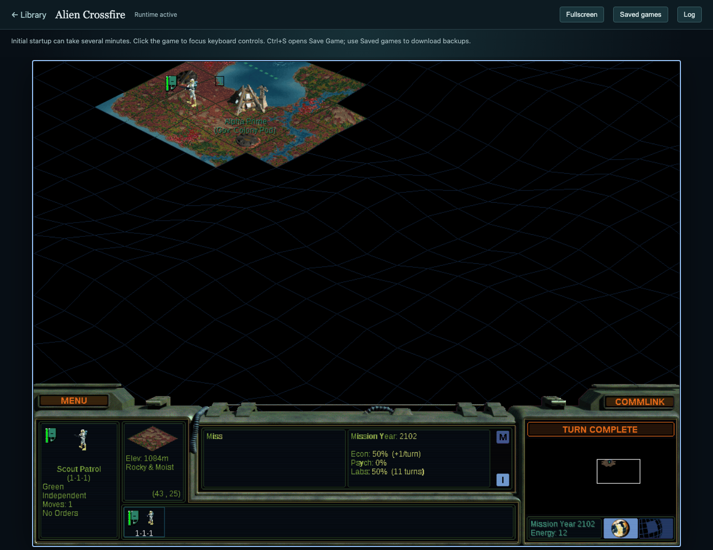
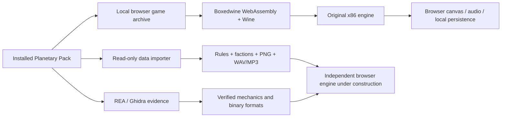

# Full-game browser port: architecture, evidence, and coverage

The goal is the full **Sid Meier's Alpha Centauri: Planetary Pack**, with its original mechanics and installed assets. This workspace supports two implementation routes and records their coverage.

1. **Original-engine browser compatibility:** execute the installed `terran.exe` or `terranx.exe` through Boxedwine's WebAssembly CPU/kernel emulation and Wine. The original compiled simulation remains responsible for gameplay. This can preserve behavior without first reconstructing every algorithm, but it depends on demonstrated compatibility and acceptable performance.
2. **Independent browser engine:** replace native systems with JavaScript/WebAssembly while reusing imported data and assets. The current independent implementation includes data import, research predicates, and the standalone map reader. Most simulation and presentation systems remain to be reconstructed and tested.

The first route now runs both original editions in the browser. Alien Crossfire has demonstrated world generation, founding Alpha Prime, moving a Scout Patrol, advancing a turn, writing a native save, and loading that save after a full Chromium process restart. The downloaded save's hash matches its pre-restart bytes. Base Alpha Centauri has demonstrated keyboard menu navigation, a new Gaian world, naming/founding a base, moving a scout, and native loading of that exported save in a fresh browser profile on the optimized runtime. These are core compatibility observations, not exhaustive campaign coverage. The second route remains a foundation for a replacement engine.

Both editions reached Mission Year 2102 with keyboard movement, and Ctrl+S opened their native save dialogs. The default player now selects `SingleThreadedJitFast`, retaining the ownership guard and focus backport and adding measured scheduler and presentation improvements. The earlier `SingleThreadedJitFocus` acceptance evidence remains available. [Base-game screenshot](analysis/runtime/browser-base-focus/native-world-final.png), [performance measurements and subsequent acceptance](analysis/performance/PERFORMANCE.md).

The [runtime validation](analysis/runtime/runtime-validation.json) distinguishes observations by emulator variant and edition. A newly created 288,396-byte save has SHA-256 `f80fefa5cf5b317716513bed7f8cea3d3fcc16bbf209352bd1675e3660a4b6b5`; it survived browser process restart and byte-identical export before the native engine resumed it. This is separate from the earlier wrapper-only imported-save test.

The original upstream JIT failed an ownership assertion on this workload, and keyboard focus needed a separate fix. The workspace retains the [JIT diagnosis and guarded build](analysis/runtime/jit/diagnosis.md), [X11 focus backport](analysis/runtime/jit/focus-backport.md), exact source/patch/artifact hashes, and a repeatable local build. All changes are to compatibility software and copied preferences; the installed game executables remain unchanged.

Runtime file events establish continued loading behind the splash, rather than a confirmed deadlock. The [startup investigation](analysis/port/startup-findings.md) traces repeated palette transformations and resource initialization; under full-image clipping, the two studied interface loops imply roughly 58.6 million pixel checks, plus extraction/copying work. That static estimate is not an instruction profile, but it is consistent with the observed slow resource progression. A short splash-only test cannot establish that startup has failed.

## What the original engine does internally

The executable loads declarative rule sections into fixed arrays. Technologies carry short IDs, flags, four AI priorities, and two prerequisites. Unit designs combine component tables; faction definitions supply strategic weights, modifiers, and presentation text. The compiled engine applies these definitions to separate map, vehicle, base, and faction state.

The new state investigation recovered these current-executable layouts:

| Structure | Storage | Evidence |
| --- | --- | --- |
| Map tiles | 44 bytes each; `tileIndex = y * (width / 2) + (x >> 1)` | Allocator `0x590ed0`, [pseudocode](analysis/native/port-code-map-allocation.c) |
| Vehicles | 52 bytes; up to 2,048 instances; position, design ID, faction, and stack links identified | Creator `0x5c03d0`, [pseudocode](analysis/native/port-code-unit-create.c) |
| Bases | 308 bytes; population at `+6`, nutrient stock at `+0x3c`, surplus at `+0xd0` | Upkeep/growth `0x4ef1c0`, [pseudocode](analysis/native/port-code-base-stage-4ef1c0.c) |
| Faction runtime | Eight records of `0x20cc` bytes | [State serializer](analysis/native/code-state-serializer.c) and turn consumers |
| Unit designs | 512 records of 52 bytes, separate from vehicle instances | [State serializer](analysis/native/code-state-serializer.c) and design lookup |

These are recovered in-memory relationships, not a complete C++ type definition or a universal save-file schema. Map coordinate parity, most tile bits, many orders, and several structure fields remain unknown.

The turn chain is observed as round processing → faction upkeep → vehicle reset/repair → economy and owned-base upkeep → further diplomacy/council stages → faction action selection. Round processing increments the turn and derives the year from a base-year value. Base iteration handles removal/compaction explicitly. [Call-chain evidence](analysis/port/state-mechanics.md).

An example where exact order matters: **growth tests existing nutrient stock before adding current surplus**. Normal growth clears old stock and recomputes resources, then adds the resulting surplus. Population caps and accelerated growth take different branches. A port that adds surplus first or preserves all overflow would diverge. This is observed static behavior, not a claim that every special growth condition has been mapped. REA Evidence `ev_a14415758bace350169843a4562ef9291d5033ca42a6d0dc047256c9879f87f7`.

Combat also needs the original arithmetic. The ordinary round branch in `0x506af0` takes **two separate random draws**, each reduced modulo its side's computed strength; a tie damages the attacker. The damage byte is changed before animation and the following health check. The artillery branch derives a candidate from the configured attack/defense ratio and reduces it to respect a remaining-health floor. These are recovered branches, not a complete combat model. [Pseudocode, machine instructions, rule bindings, and exact evidence IDs](analysis/port/combat-findings.md).

The RNG reached from those branches is a 32-bit recurrence: `state = state * 0x343fd + 0x269ec3`, wrapping at 32 bits, returning `(state >> 16) & 0x7fff`. Matching the formula alone is insufficient: a replacement must also match the seed and every intervening draw. Seed initialization and all RNG consumers remain untraced.

Production runs before population growth. Its admitted accumulation branch adds eligible mineral surplus before testing completion. Completion subtracts the computed cost and can cap the remainder, conditioned on a faction bit; queue advancement discards unavailable entries without itself resetting mineral stock. The cost factors, overflow condition, and special completion branches must survive a replacement. [Exact base offsets, queue pseudocode, and corroborating x86 instructions](analysis/port/production-mechanics.md).

## Data and asset reuse

The importer produces both original text and typed records, preserving order, source lines, byte spans, and SHA-256 identities. The validated result includes:

- Both rule sets, 14 registered factions, two bonus faction files, the faction template, and the tutorial rule override.
- 760 PNG conversions from all 760 PCX files; palette color values are retained. One scanline-crossing source uses a bounded, explicitly recorded RLE fallback.
- 508 byte-identical WAV/MP3 files.
- An inventory of 1,632 resources, including unsupported formats; the standalone data importer excludes saves and transient session files.
- Four original `.MP` maps read by the independent version-5 parser, preserving the complete header, 44-byte tile records, and secondary buffer.

Twenty parsed text documents round-trip to their original bytes, and all 1,268 generated media hashes were checked. Repeating the import yields the same manifest. [Validation](analysis/port/assets-validation.json).

The original-engine archive uses the complete installation, including both executables and all media. Its [per-file manifest](analysis/runtime/game-bundle-manifest.json) distinguishes source bytes from any copied INI changes. This archive is separate from the reusable data importer.

## Independent implementation coverage

| Subsystem | Current status | What complete compatibility still requires |
| --- | --- | --- |
| Rules and faction data | Imported with source provenance | Match all parser coercion/clamping, overrides, and runtime lookup behavior |
| Research ownership, eligibility, depth | Implemented from recovered code; six focused checks | Differential execution against native state and integration with the complete simulation |
| Research AI | Scorer and selection decompiled | Translate all context adjustments, random branches, and exact random-number behavior |
| Standalone maps | Version-5 reader; four shipped files validated | Apply post-load fixups, determine tile semantics/parity, reconstruct generation and terrain yields |
| Units and bases | Selected layouts and creation/upkeep paths recovered | Movement, transport, combat, production, orders, deletion, and all state fields |
| Combat and randomness | Round comparison, damage ordering, artillery bounds, and RNG arithmetic recovered | Full strength modifiers, seed/draw sequence, retreat and special cases; native differential tests |
| Production | Accumulation/completion order, conditional carryover, and queue filtering recovered | Cost factors, faction/flag semantics, projects, governors, capacity and failure branches |
| Population growth | Update order and major branches recovered | Identify every cap/project/policy predicate and compare edge cases at runtime |
| Diplomacy, social engineering, AI, victories | Original binary available; independent implementation absent | Systematic traces and reference scenarios across all rule variants |
| Images and audio | PNG plus original WAV/MP3 available | Exact atlas slicing, palette effects, timing, mixing, and interface integration |
| Voxels and movies | Inventoried | CVR geometry/animation and movie decoders, render parity |
| Legacy saves | Signature, writer boundary, blocks and layouts partly traced | Complete versioned schema, fixups, compression paths, save/load round trips |
| Multiplayer | DirectPlay boundary identified | Protocol and synchronization reconstruction; currently unverified |

## Acceptance checks for the complete browser game

The core checks above have passed, with native process restart/load tested on Alien Crossfire and native imported-save restoration tested on base Alpha Centauri. Broader compatibility validation still needs sustained production and research progression, combat, diplomacy/social changes, AI campaigns, all victory paths, and base-edition save/reload across browser restarts. Media, large maps, long games, other browsers, and performance also need coverage.

For the independent engine, tests should compare state transitions against native scenarios with fixed initial conditions and controlled random input. The REA addresses, source hashes, and preserved raw data provide the starting point for those comparisons. Unit tests against a transcription alone do not prove full parity.

## Reproducibility and limits

The principal analyzed executable is `terranx.exe`, SHA-256 `573fd44cf18392da7cd048e2d8c24a8e130034364f374647e34e79a6c621d6f4`. The initial 64-record native bundle, 21-record state bundle, 8-record map bundle, 55-record startup bundle, 13-record combat bundle, and 7-record production bundle retain **168 REA evidence records**, with launcher evidence separate. Decompiled names and types are generated; semantic names in the reports are labeled observations or inferences.

The browser compatibility software is checksum-pinned to an official upstream build. [Source and artifact identities](analysis/runtime/runtime-provenance.json) are retained, as are runtime logs and screenshots. Browser compatibility observations are separate from REA's static evidence. No static decompilation alone establishes successful execution or complete game compatibility.
